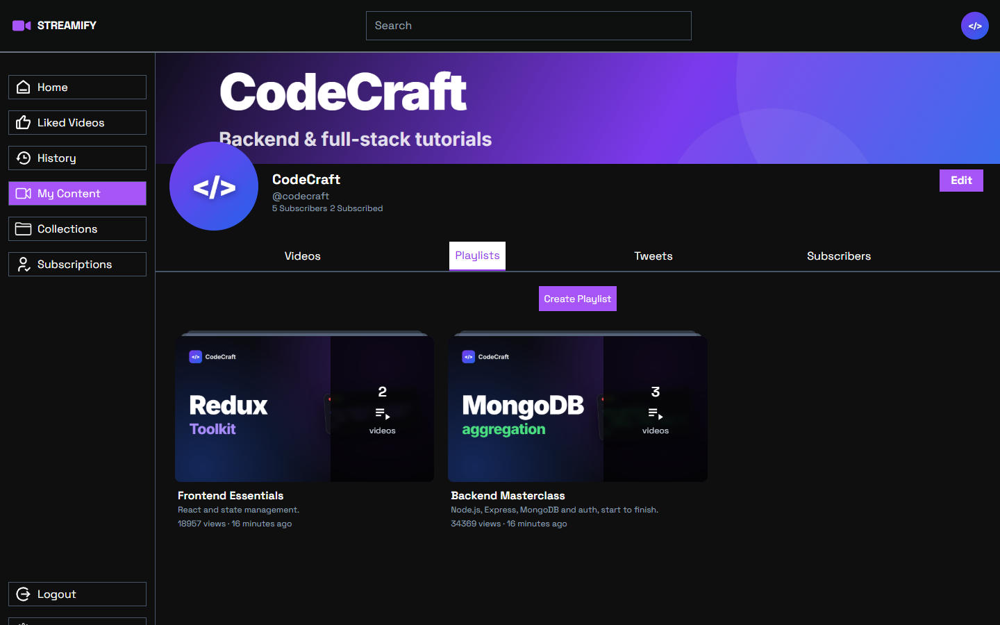
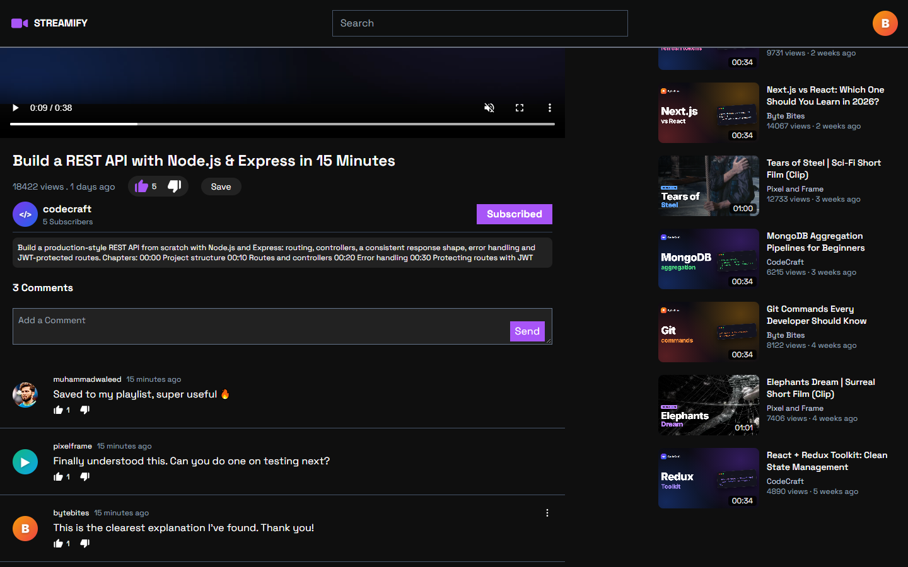
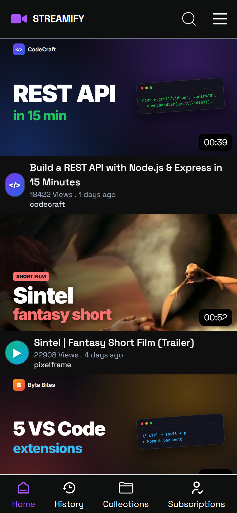
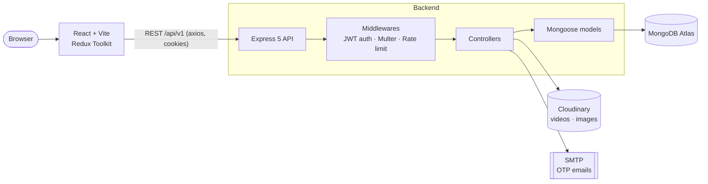

<div align="center">


# Streamify

**A full-stack video platform: upload, stream, comment, subscribe and track your channel's growth.**

[**Live Demo**](https://streamify-three-weld.vercel.app) · [Features](#-features) · [Screenshots](#-screenshots) · [Run Locally](#-run-locally) · [API](#-api-overview)


<br />


</div>

---

## 📌 What is Streamify?

Streamify is a YouTube-style platform built from scratch with the MERN stack. **Viewers** browse, watch, like, comment and subscribe. **Creators** upload videos, organize playlists, post community updates and see their stats on a dashboard.

The backend is a layered REST API (routes → controllers → models) with JWT auth, rate limiting, a consistent response format and MongoDB aggregation pipelines for feeds and analytics.

---

## ✨ Features

<table>
<tr>
<td width="50%" valign="top">

### 🎬 Watching
- Infinite-scroll home feed (cursor pagination, newest first)
- Search across titles and descriptions
- Video player with MP4 and HLS (`.m3u8`) support
- **Up next** recommendations beside the player
- Likes, comments and comment likes
- Watch history and liked videos

</td>
<td width="50%" valign="top">

### 🎥 Creating
- Upload videos (up to 100 MB) with custom thumbnails
- Chunked uploads to Cloudinary
- Publish / unpublish, edit and delete videos
- Channel page: videos, playlists, community posts, subscribers
- Playlists with auto-generated covers
- Creator dashboard: views, subscribers, videos, likes

</td>
</tr>
<tr>
<td valign="top">

### 🔐 Accounts
- Sign up with avatar and cover image
- JWT access + refresh tokens with rotation
- Tokens stored in **HTTP-only cookies**
- Password reset with email OTP
- Edit profile, avatar, cover and password

</td>
<td valign="top">

### 🛡️ Security & reliability
- Rate limits on OTP and reset endpoints
- Blocks NoSQL injection (rejects nested objects in request bodies)
- Global error handler: validation, cast, duplicate-key and JWT errors become clean 4xx responses
- Temp upload files cleaned up on failure
- CORS allow-list from environment

</td>
</tr>
</table>

---

## 📸 Screenshots

| Video player + Up next | Creator dashboard |
|:---:|:---:|
|  |  |
| **Channel page** | **Playlists** |
|  |  |
| **Upload video** | **Comments** |
|  |  |

<details>
<summary><b>📱 Mobile view</b></summary>
<br />

</details>

---

## 🏗️ Architecture



Every response, success or error, has the same shape:

```json
{ "statusCode": 200, "success": true, "message": "Video fetched successfully", "data": {} }
```

---

## 🧰 Tech Stack

| Layer | Technologies |
|---|---|
| **Frontend** | React 18, Vite, Redux Toolkit, React Router 6, React Hook Form, Tailwind CSS, hls.js, react-hot-toast |
| **Backend** | Node.js, Express 5, Mongoose (aggregation pipelines, pagination), express-rate-limit |
| **Auth** | JWT (access + refresh), bcrypt, HTTP-only cookies, email OTP (Nodemailer) |
| **Media** | Cloudinary (chunked video upload, images), Multer |
| **Hosting** | Vercel (frontend) · Railway (backend) · MongoDB Atlas |

---

## 🔌 API Overview

Base URL: `/api/v1`. All routes except sign up, login, refresh, password reset, the public feed and health check require a valid access token.

| Resource | Key endpoints |
|---|---|
| **users** | `POST /register` · `POST /login` · `POST /logout` · `POST /refresh-token` · `POST /forgot-password` · `POST /reset-password` · `GET /channel/:username` · `GET /watch-history` |
| **videos** | `GET /get-all` (search + cursor) · `POST /publish-video` · `GET /get-video/:id` · `PATCH /update-video/:id` · `PATCH /toggle-publish/:id` · `DELETE /delete-video/:id` |
| **comments** | `GET/POST /:videoId` · `PATCH/DELETE /c/:commentId` |
| **likes** | `POST /toggle/v/:videoId` · `POST /toggle/c/:commentId` · `POST /toggle/t/:tweetId` · `GET /videos` |
| **subscriptions** | `GET/POST /c/:channelId` · `GET /u/:subscriberId` |
| **playlists** | `POST /` · `GET/PATCH/DELETE /:playlistId` · `PATCH /add/:videoId/:playlistId` · `PATCH /remove/:videoId/:playlistId` · `GET /user/:userId` |
| **tweets** (community posts) | `POST /` · `GET /user/:userId` · `PATCH/DELETE /:tweetId` |
| **dashboard** | `GET /stats` · `GET /videos` |
| **healthcheck** | `GET /` |

---

## 🚀 Run Locally

**Prerequisites:** Node.js 18+, a MongoDB database (local or Atlas), a Cloudinary account and an SMTP account (Mailtrap works for testing).

```bash
# 1. Clone
git clone https://github.com/WaleedAkram01/STREAMIFY.git
cd STREAMIFY

# 2. Backend
cd backend
cp .env.example .env      # fill in the values below
npm install
npm run dev               # http://localhost:5000

# 3. Frontend (new terminal)
cd frontend
cp .env.sample .env       # VITE_BACKEND_URL=http://localhost:5000/api/v1
npm install
npm run dev               # http://localhost:5173
```

### Environment variables

<details>
<summary><b>Backend <code>.env</code></b></summary>

| Key | Description |
|---|---|
| `PORT` | API port |
| `NODE_ENV` | `development` or `production` (affects cookies and error details) |
| `CORS_ORIGIN` | Comma-separated list of allowed frontend URLs |
| `MONGO_URI` | MongoDB connection string (database name is added by the app) |
| `ACCESS_TOKEN_SECRET` / `ACCESS_TOKEN_EXPIRY` | Access token signing secret and lifetime |
| `REFRESH_TOKEN_SECRET` / `REFRESH_TOKEN_EXPIRY` | Refresh token signing secret and lifetime |
| `CLOUDINARY_CLOUD_NAME` / `CLOUDINARY_API_KEY` / `CLOUDINARY_API_SECRET` | Cloudinary credentials |
| `SMTP_HOST` / `SMTP_PORT` / `SMTP_USER` / `SMTP_PASS` | SMTP server for OTP emails |
| `SMTP_FROM_EMAIL` / `SMTP_FROM_NAME` | Sender shown on OTP emails |

</details>

<details>
<summary><b>Frontend <code>.env</code></b></summary>

| Key | Description |
|---|---|
| `VITE_BACKEND_URL` | Base URL of the API |

</details>

---

## 📁 Project Structure

```
STREAMIFY/
├── backend/
│   ├── server.js            # loads env, connects DB, starts server
│   ├── app.js               # middlewares, routes, global error handler
│   └── src/
│       ├── config/          # database connection
│       ├── models/          # User, Video, Comment, Like, Tweet, Playlist, Subscription
│       ├── controllers/     # business logic per resource
│       ├── routes/          # one router per resource
│       ├── middlewares/     # JWT auth, Multer uploads
│       └── utils/           # ApiResponse, ApiError, asyncHandler, Cloudinary, email
└── frontend/
    └── src/
        ├── pages/           # Home, VideoDetail, Channel, Dashboard, Playlist...
        ├── components/      # Video player, UpNext, PlaylistCover, forms, layout
        ├── store/Slices/    # Redux Toolkit slices per resource
        └── helpers/         # axios instance (auto token refresh), time helpers
```

---

## 🗺️ Roadmap

- [x] Cursor-based infinite scroll feed
- [x] JWT refresh token rotation + OTP password reset
- [x] Creator dashboard with aggregated stats
- [x] Up next recommendations and playlist covers
- [ ] Adaptive HLS transcoding for every upload
- [ ] Redis caching for the home feed
- [ ] Real-time notifications (new uploads from subscriptions)
- [ ] Automated tests (Jest + Supertest)

---

## 🎞️ Demo Content Credits

Some demo videos are clips from Blender Foundation open movies (Big Buck Bunny, Sintel, Tears of Steel, Elephants Dream), licensed under Creative Commons Attribution. Credits are included in each video's description.

---

## 👤 Author

**Waleed Akram**, Full-Stack Developer (MERN · Next.js)

[](https://github.com/WaleedAkram01)

If you found this project useful, consider giving it a ⭐
