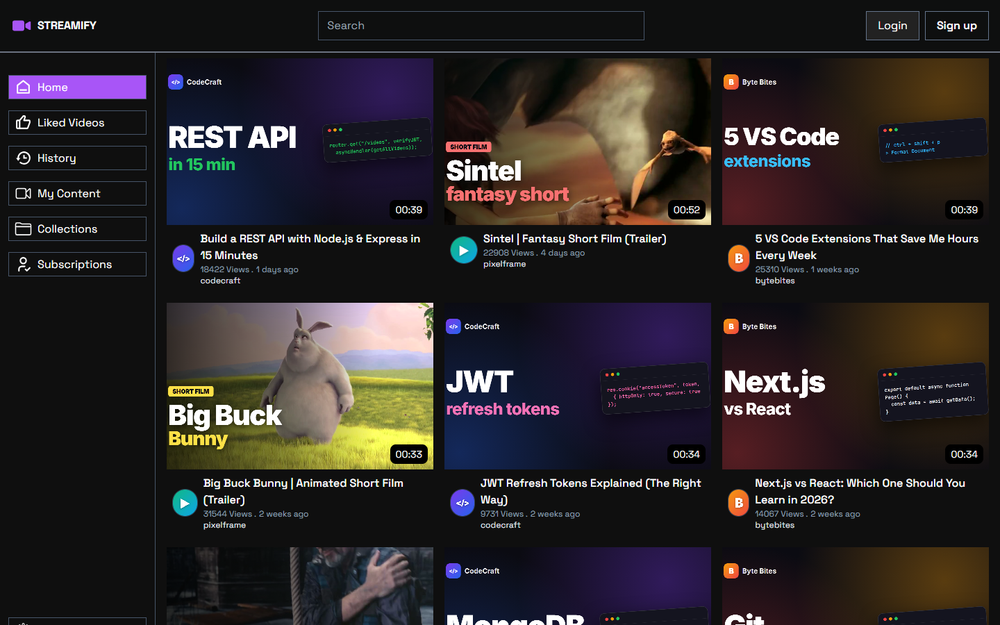
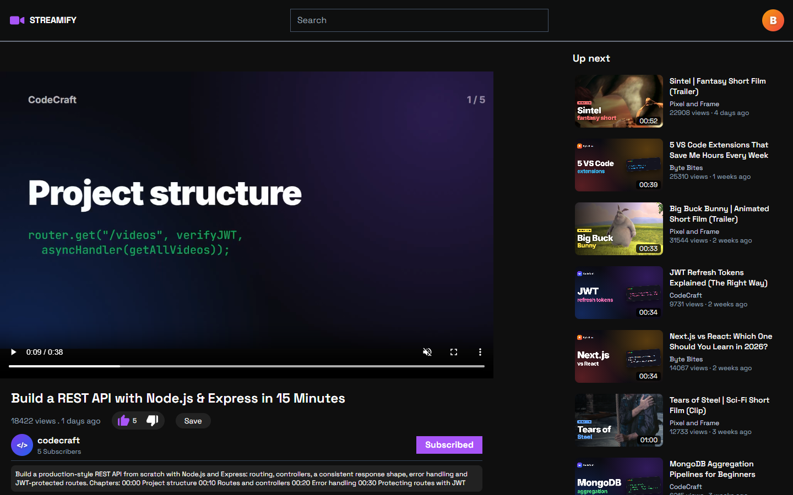
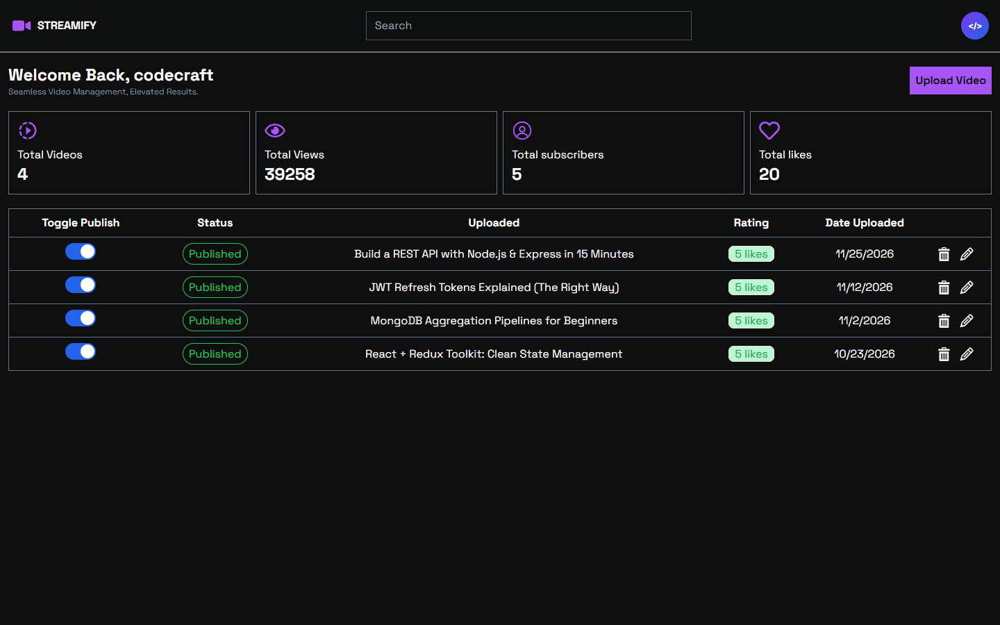
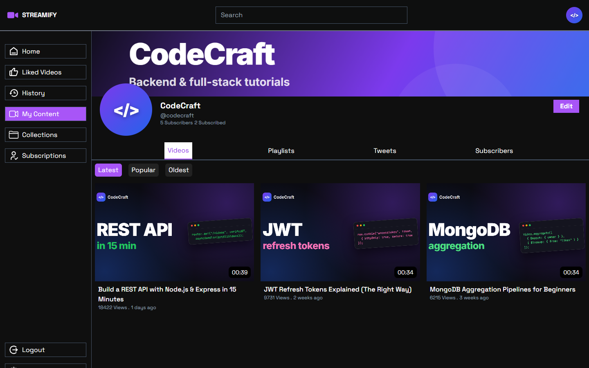
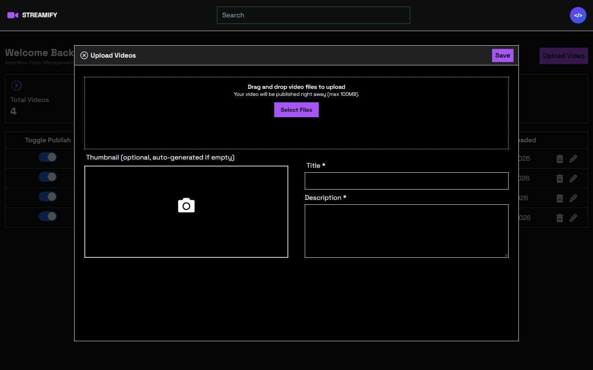

# Streamify

A full-stack video platform where creators upload and stream videos, grow subscribers, post community updates and track channel analytics.

**Live demo:** https://streamify-three-weld.vercel.app



## Features

**Viewers**
- Browse and search videos with infinite scroll
- Video player with MP4 and HLS (`.m3u8`) support via hls.js
- Like videos, comments and posts; comment on videos
- Subscribe to channels and see a subscriptions feed
- Watch history, liked videos and playlists

**Creators**
- Upload videos with custom thumbnails (chunked upload to Cloudinary)
- Publish or unpublish, edit and delete videos
- Channel page with videos, playlists, community posts and subscribers
- Creator dashboard: total views, subscribers, videos and likes

**Accounts and security**
- JWT access and refresh tokens with rotation, stored in HTTP-only cookies
- Password reset with email OTP, rate-limited to stop abuse
- Avatar and cover image uploads
- Input hardening: rejects nested objects in request bodies (blocks NoSQL injection like `{ "$gt": "" }`)
- One global error handler with a consistent JSON response shape

## Tech stack

| Layer | Tech |
|---|---|
| Frontend | React 18, Vite, Redux Toolkit, React Router, React Hook Form, Tailwind CSS, hls.js |
| Backend | Node.js, Express 5, MongoDB, Mongoose (aggregation pipelines + pagination) |
| Media | Cloudinary (video and image storage), Multer |
| Auth | JWT (access + refresh), bcrypt, HTTP-only cookies |
| Email | Nodemailer (OTP password reset) |
| Deploy | Vercel (frontend), Railway (backend), MongoDB Atlas |

## Architecture

```
React (Vite) ──axios──▶ Express REST API (/api/v1)
                          ├── routes → controllers → models (Mongoose)
                          ├── middlewares: JWT auth, Multer uploads, rate limits
                          └── utils: ApiResponse, ApiError, asyncHandler
                                   │
                     MongoDB Atlas ◀┘└▶ Cloudinary (videos, thumbnails, avatars)
```

API resources: `users`, `videos`, `comments`, `likes`, `tweets` (community posts), `subscriptions`, `playlists`, `dashboard`, `healthcheck`.

Every response uses the same shape:

```json
{ "statusCode": 200, "success": true, "message": "Video fetched successfully", "data": {} }
```

## Run locally

```bash
# Backend
cd backend
cp .env.example .env   # fill in MongoDB, JWT, Cloudinary and SMTP values
npm install
npm run dev

# Frontend
cd frontend
cp .env.sample .env    # set VITE_BACKEND_URL
npm install
npm run dev
```

## Screenshots

| Video player | Creator dashboard |
|---|---|
|  |  |

| Channel | Upload |
|---|---|
|  |  |

## Author

**Waleed Akram**, Full-Stack Developer (MERN, Next.js)
GitHub: [@WaleedAkram01](https://github.com/WaleedAkram01)
